# InfraBot

English · [简体中文](README.zh-CN.md)

**An open-source seven-axis arm with Damiao CAN FD joints and an STM32H743 controller.** The controller runs the joint loop at 1 kHz on the arm. It also runs gravity compensation, impedance and admittance control. A PC drives it over Ethernet with a C++ or Python SDK.

[**Documentation**](https://yaolindong.github.io/infrabot/) · [Demo videos](https://yaolindong.github.io/infrabot/docs/demos) · [Quick start](#start-here) · [Repositories](#repositories) · [Compatibility](VERSIONS.md) · [Safety](SAFETY.md)

<p align="center">
  
</p>

| Joints | Actuators | Arm mass | Control loop | Joint bus | Host link |
|:---:|:---:|:---:|:---:|:---:|:---:|
| 7 + optional gripper | Damiao DM8009P · DM4340P · DM4310 | 4.63 kg | 1 kHz on the MCU | CAN FD, 1 / 5 Mbit/s | Ethernet UDP |

> [!NOTE]
> InfraBot is maintained by one person and is in its first public release. The robot description, arm mechanical CAD, controller board and its enclosure, firmware and SDK are all published. Signed firmware packages are attached to the firmware releases, and the SDK flash tools can download them. Reach, payload and repeatability have not been measured and are therefore not listed.

## Highlights

- **Controller runs the control loop.** The STM32H743 runs 1 kHz joint control, inverse kinematics, gravity compensation, joint and Cartesian impedance, and joint and Cartesian admittance. Gravity, impedance and admittance modes keep running without a PC stream.
- **Real-time and planned motion.** The host can stream 1 kHz joint or Cartesian targets, or submit `movej` and `movep` goals that the controller interpolates.
- **Touchscreen in English and Chinese.** The 4.3-inch panel shows drive status, network settings, compliance parameters and a 3D view of the arm, with STOP on every page. The 5-inch panel uses an English layout.
- **Signed A/B firmware updates.** Updates are installed over Ethernet with approval on the touchscreen. A failed trial boot reverts to the previous application. SWD recovery is also supported.
- **Open hardware and models.** The arm ships with an assembly STEP, STEP files for every machined part and a BOM. The carrier board ships with editable EasyEDA sources and Gerbers, and its 3D-printed enclosure with STL and STEP. The URDF includes identified inertia and friction.
- **Supervised stopping.** Stream loss, stale feedback and drive faults bring the arm to a controlled stop in an enabled hold. A separately wired hardware emergency stop is still required. Read the [safety guide](SAFETY.md) first.

## Demos

<table align="center">
  <tr>
    <td align="center"><a href="website/static/video/gravity-compensation.mp4">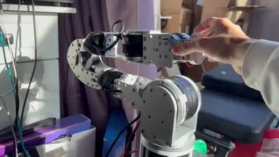</a><br><sub>Gravity compensation</sub></td>
    <td align="center"><a href="website/static/video/joint-impedance.mp4"></a><br><sub>Joint impedance</sub></td>
    <td align="center"><a href="website/static/video/cartesian-impedance.mp4">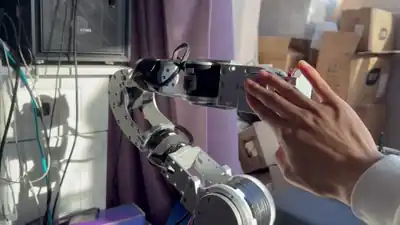</a><br><sub>Cartesian impedance</sub></td>
  </tr>
  <tr>
    <td align="center"><a href="website/static/video/joint-admittance.mp4">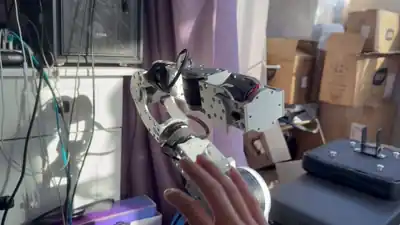</a><br><sub>Joint admittance</sub></td>
    <td align="center"><a href="website/static/video/cartesian-admittance.mp4"></a><br><sub>Cartesian admittance</sub></td>
  </tr>
</table>
<p align="center"><sub>Each mode runs at 1 kHz on the controller, without a PC command stream. Click a clip for the full video.</sub></p>

## Touchscreen

<table align="center">
  <tr>
    <td align="center">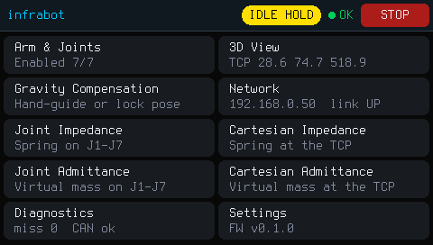<br><sub>Main menu</sub></td>
    <td align="center">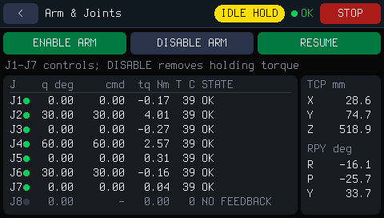<br><sub>Arm and joints</sub></td>
    <td align="center">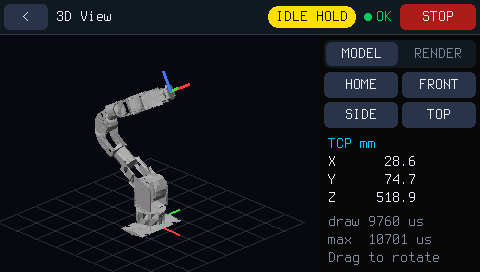<br><sub>3D view</sub></td>
  </tr>
  <tr>
    <td align="center">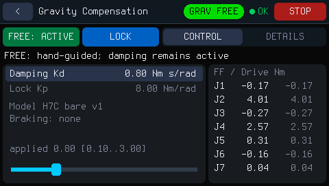<br><sub>Gravity compensation</sub></td>
    <td align="center">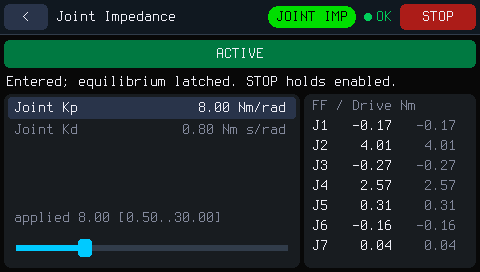<br><sub>Joint impedance</sub></td>
    <td align="center">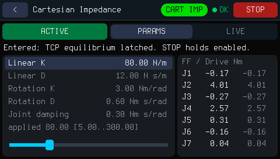<br><sub>Cartesian impedance</sub></td>
  </tr>
  <tr>
    <td align="center">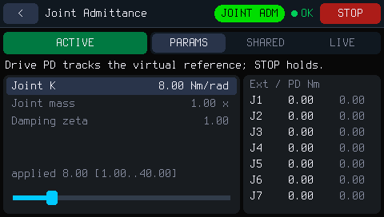<br><sub>Joint admittance</sub></td>
    <td align="center">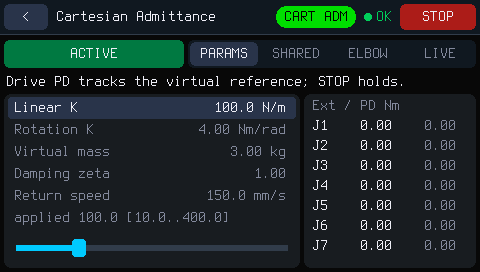<br><sub>Cartesian admittance</sub></td>
    <td align="center">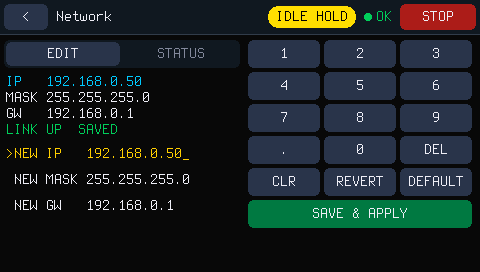<br><sub>Network settings</sub></td>
  </tr>
  <tr>
    <td align="center">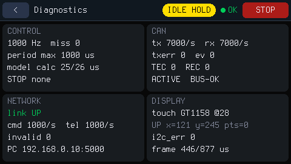<br><sub>Diagnostics</sub></td>
    <td align="center">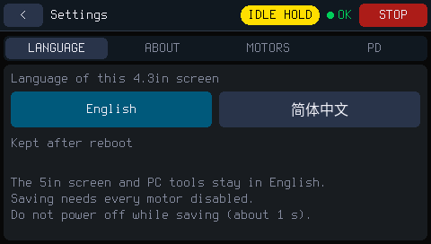<br><sub>Display language</sub></td>
    <td align="center">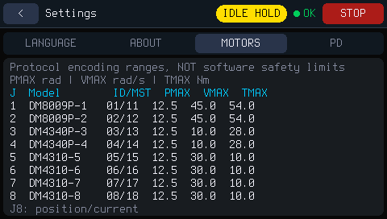<br><sub>Motor table</sub></td>
  </tr>
</table>
<p align="center"><sub>Every page of the 4.3-inch interface, also available in Simplified Chinese. STOP stays in the top-right corner of every page. The screenshots come from the firmware host tests, which run the controller's UI code with simulated joint data. Click an image for full size.</sub></p>

## Start here

| I want to… | Go to |
|---|---|
| See the arm in RViz or load the URDF | [infrabot-description](https://github.com/YaolinDong/infrabot-description) |
| Machine the arm's parts | [infrabot-hardware](https://github.com/YaolinDong/infrabot-hardware) · [BOM](https://github.com/YaolinDong/infrabot-hardware#bill-of-materials) |
| Build the controller board | [infrabot-pcb-4p3](https://github.com/YaolinDong/infrabot-pcb-4p3) · [assembly guide](https://github.com/YaolinDong/infrabot-pcb-4p3/blob/main/docs/assembly.md) |
| Print an enclosure for the controller | [infrabot-enclosure-4p3](https://github.com/YaolinDong/infrabot-enclosure-4p3) · [S8 assembly](https://github.com/YaolinDong/infrabot-enclosure-4p3/blob/main/simple/README.md) · [C3 assembly](https://github.com/YaolinDong/infrabot-enclosure-4p3/blob/main/deluxe/README.md) |
| Build and flash the firmware | [infrabot-firmware](https://github.com/YaolinDong/infrabot-firmware) · [build](https://github.com/YaolinDong/infrabot-firmware/blob/main/docs/build.md) · [flashing](https://github.com/YaolinDong/infrabot-firmware/blob/main/docs/flashing.md) |
| Control the arm from C++ or Python | [infrabot-sdk](https://github.com/YaolinDong/infrabot-sdk) · [API](https://github.com/YaolinDong/infrabot-sdk/blob/main/docs/api.md) · [examples](https://github.com/YaolinDong/infrabot-sdk/tree/main/examples) |
| Check which versions work together | [VERSIONS.md](VERSIONS.md) |
| Operate the arm safely | [SAFETY.md](SAFETY.md) |

## Repositories

<!-- repos:start -->
| Repository | Contents | Status | Version | License |
|---|---|---|---|---|
| [infrabot-hardware](https://github.com/YaolinDong/infrabot-hardware) | H7C arm mechanical CAD: assembly STEP with the joint motors, STEP files for the 43 machined parts, and a BOM with part previews. | Available | 0.1.0 | CERN-OHL-S-2.0 · MIT · CC-BY-4.0 |
| [infrabot-pcb-4p3](https://github.com/YaolinDong/infrabot-pcb-4p3) | Four-layer carrier board for the STM32H743 core module and 4.3-inch panel: EasyEDA project, schematics, Gerbers, BOM and CPL. | Available | R8 | CERN-OHL-P-2.0 · MIT · CC-BY-4.0 |
| [infrabot-enclosure-4p3](https://github.com/YaolinDong/infrabot-enclosure-4p3) | 3D-printable enclosures for the 4.3-inch controller: Simple S8 with two shells and Deluxe C3 with keycaps and light pipes. STL and STEP. | Available | S8 · C3 | CERN-OHL-P-2.0 · MIT · CC-BY-4.0 |
| [infrabot-firmware](https://github.com/YaolinDong/infrabot-firmware) | STM32H743 firmware: 1 kHz joint control, gravity compensation, impedance and admittance, touchscreen UI, signed A/B updates. | Available | 0.1.1 | Apache-2.0 |
| [infrabot-sdk](https://github.com/YaolinDong/infrabot-sdk) | Linux C++17 and Python SDK over Ethernet, Qt control GUI and firmware update tools. | Available | 0.1.2 | Apache-2.0 |
| [infrabot-description](https://github.com/YaolinDong/infrabot-description) | H7C URDF, meshes and identified inertia and friction. ROS 2 Jazzy package. | Available | 0.1.0 | Apache-2.0 |
| `infrabot-ros2` | ROS 2 driver. | Planned | — | — |
| `lerobot-robot-infrabot` | LeRobot robot plugin for teleoperation, recording and policy deployment. | Planned | — | — |
<!-- repos:end -->

## How it fits together

```text
PC: C++ / Python SDK, Qt GUI
 ▲
 │  Ethernet UDP: commands down, telemetry and replies up
 ▼
Controller: STM32H743 on the carrier board, with a touch panel
            1 kHz joint loop · kinematics · gravity · impedance · admittance
 ▲
 │  CAN FD: drive commands down, motor feedback up
 ▼
Joint motors: J1–J2 DM8009P · J3–J4 DM4340P · J5–J7 DM4310 · J8 gripper
```

The controller is the single owner of the drives. One PC holds the control lease at a time. The touchscreen can STOP the arm at any time. The wire protocol is versioned: the SDK checks the controller's protocol major version before it starts sending commands. See [VERSIONS.md](VERSIONS.md) for which releases work together.

## Safety

> [!WARNING]
> This is a research arm, not a certified industrial or collaborative robot. Its software limits and controlled stop do not remove drive power. Wire an independent hardware emergency stop. Keep people outside the reach of the arm while it is enabled. Support the arm before you disable the drives or cut power. Read [SAFETY.md](SAFETY.md) before the first power-up.

## Contributing and support

Open an issue in the repository the problem belongs to. Use this repository for documentation, cross-repository questions and the website. Include the firmware and SDK versions, the controller board revision and the steps to reproduce the problem. Report security issues privately as described in [SECURITY.md](SECURITY.md). Contributions and translations are welcome; see [CONTRIBUTING.md](CONTRIBUTING.md).

If InfraBot helps your work, you can cite it using [CITATION.cff](CITATION.cff).

## Acknowledgments

Special thanks to [@crystal0-0](https://github.com/crystal0-0) and [@xensexyq](https://github.com/xensexyq) for their support of InfraBot.

<p>
  <a href="https://github.com/crystal0-0"></a>
  <a href="https://github.com/xensexyq"></a>
</p>

## License

Each repository states its own license. Software, firmware and the robot description use Apache-2.0. The carrier board and enclosure designs use CERN-OHL-P-2.0, their tools use MIT, and their documentation and images use CC-BY-4.0. Third-party components keep their original licenses. Each repository lists them in its own notices.

This repository, including its website, documentation and images, is licensed under [Apache-2.0](LICENSE). The carrier board render `website/static/img/pcb-4p3.png` comes from [infrabot-pcb-4p3](https://github.com/YaolinDong/infrabot-pcb-4p3) and stays under CC-BY-4.0.

Copyright © 2026 **YaolinDong (董耀琳)** · [dong1505lin@gmail.com](mailto:dong1505lin@gmail.com)
