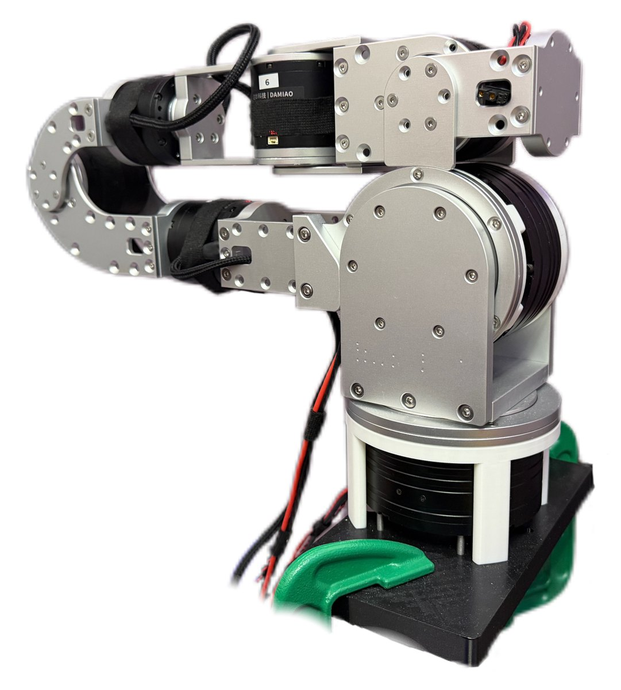
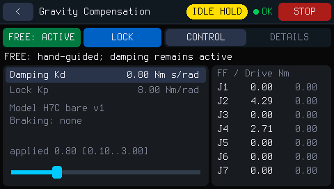

# InfraBot

English · [简体中文](README.zh-CN.md)

**An open-source seven-axis arm with Damiao CAN FD joints and an STM32H743 controller.** The controller runs the joint loop at 1 kHz on the arm. It also runs gravity compensation, impedance and admittance control. A PC drives it over Ethernet with a C++ or Python SDK.

[**Documentation**](https://yaolindong.github.io/infrabot/) · [Demo videos](https://yaolindong.github.io/infrabot/docs/demos) · [Quick start](#start-here) · [Repositories](#repositories) · [Compatibility](VERSIONS.md) · [Safety](SAFETY.md)

<p align="center">
  
  
</p>
<p align="center"><sub>Gravity compensation on the controller, guided by hand. More clips: <a href="website/static/video/gravity-compensation.mp4">gravity compensation</a> · <a href="website/static/video/joint-impedance.mp4">joint impedance</a> · <a href="website/static/video/cartesian-impedance.mp4">Cartesian impedance</a> · <a href="website/static/video/joint-admittance.mp4">joint admittance</a> · <a href="website/static/video/cartesian-admittance.mp4">Cartesian admittance</a></sub></p>

| Joints | Actuators | Arm mass | Control loop | Joint bus | Host link |
|:---:|:---:|:---:|:---:|:---:|:---:|
| 7 + optional gripper | Damiao DM8009P · DM4340P · DM4310 | 4.63 kg | 1 kHz on the MCU | CAN FD, 1 / 5 Mbit/s | Ethernet UDP |

> [!NOTE]
> InfraBot is maintained by one person and is in its first public release. The robot description and controller board are available now. Firmware and SDK repositories are being prepared for release. Reach, payload and repeatability have not been measured and are therefore not listed.

## Highlights

- **Controller runs the control loop.** The STM32H743 runs 1 kHz joint control, inverse kinematics, gravity compensation, joint and Cartesian impedance, and joint and Cartesian admittance. Gravity, impedance and admittance modes keep running without a PC stream.
- **Real-time and planned motion.** The host can stream 1 kHz joint or Cartesian targets, or submit `movej` and `movep` goals that the controller interpolates.
- **Touchscreen in English and Chinese.** The 4.3-inch panel shows drive status, network settings, compliance parameters and a 3D view of the arm, with STOP on every page. The 5-inch panel uses an English layout.
- **Signed A/B firmware updates.** Updates are installed over Ethernet with approval on the touchscreen. A failed trial boot reverts to the previous application. SWD recovery is also supported.
- **Open hardware and models.** The carrier board ships with editable EasyEDA sources and Gerbers. The URDF includes identified inertia and friction.
- **Supervised stopping.** Stream loss, stale feedback and drive faults bring the arm to a controlled stop in an enabled hold. A separately wired hardware emergency stop is still required. Read the [safety guide](SAFETY.md) first.

<p align="center">
  
  
</p>

## Start here

| I want to… | Go to |
|---|---|
| See the arm in RViz or load the URDF | [infrabot-description](https://github.com/YaolinDong/infrabot-description) |
| Build the controller board | [infrabot-pcb-4p3](https://github.com/YaolinDong/infrabot-pcb-4p3) · [assembly guide](https://github.com/YaolinDong/infrabot-pcb-4p3/blob/main/docs/assembly.md) |
| Build and flash the firmware | `infrabot-firmware` (preparing) |
| Control the arm from C++ or Python | `infrabot-sdk` (preparing) |
| Check which versions work together | [VERSIONS.md](VERSIONS.md) |
| Operate the arm safely | [SAFETY.md](SAFETY.md) |

## Repositories

<!-- repos:start -->
| Repository | Contents | Status | Version | License |
|---|---|---|---|---|
| [infrabot-description](https://github.com/YaolinDong/infrabot-description) | H7C URDF, meshes and identified inertia and friction. ROS 2 Jazzy package. | Available | 0.1.0 | Apache-2.0 |
| [infrabot-pcb-4p3](https://github.com/YaolinDong/infrabot-pcb-4p3) | Four-layer carrier board for the STM32H743 core module and 4.3-inch panel: EasyEDA project, schematics, Gerbers, BOM and CPL. | Available | R8 | CERN-OHL-P-2.0 · MIT · CC-BY-4.0 |
| `infrabot-firmware` | STM32H743 firmware: 1 kHz joint control, gravity compensation, impedance and admittance, touchscreen UI, signed A/B updates. | Preparing | 0.1.0 | Apache-2.0 |
| `infrabot-sdk` | Linux C++17 and Python SDK over Ethernet, Qt control GUI and firmware update tools. | Preparing | 0.1.0 | Apache-2.0 |
| `infrabot-ros2` | ROS 2 driver. | Planned | — | — |
| `lerobot-robot-infrabot` | LeRobot robot plugin for teleoperation, recording and policy deployment. | Planned | — | — |
| `infrabot-hardware` | Mechanical CAD, bill of materials and assembly guide. | Planned | — | — |
<!-- repos:end -->

## How it fits together

```text
PC ── C++ / Python SDK, Qt GUI ── Ethernet UDP ──┐
                                                  ▼
          STM32H743 controller on the carrier board, with a touch panel
            1 kHz joint loop · kinematics · gravity · impedance · admittance
                                                  │ CAN FD
                                                  ▼
          J1–J2 DM8009P · J3–J4 DM4340P · J5–J7 DM4310 · J8 gripper
```

The controller is the single owner of the drives. One PC holds the control lease at a time. The touchscreen can STOP the arm at any time. The wire protocol is versioned: the SDK checks the controller's protocol major version before it starts sending commands. See [VERSIONS.md](VERSIONS.md) for which releases work together.

## Safety

> [!WARNING]
> This is a research arm, not a certified industrial or collaborative robot. Its software limits and controlled stop do not remove drive power. Wire an independent hardware emergency stop. Keep people outside the reach of the arm while it is enabled. Support the arm before you disable the drives or cut power. Read [SAFETY.md](SAFETY.md) before the first power-up.

## Contributing and support

Open an issue in the repository the problem belongs to. Use this repository for documentation, cross-repository questions and the website. Include the firmware and SDK versions, the controller board revision and the steps to reproduce the problem. Report security issues privately as described in [SECURITY.md](SECURITY.md). Contributions and translations are welcome; see [CONTRIBUTING.md](CONTRIBUTING.md).

If InfraBot helps your work, you can cite it using [CITATION.cff](CITATION.cff).

## License

Each repository states its own license. Software, firmware and the robot description use Apache-2.0. The carrier board design uses CERN-OHL-P-2.0, its tools use MIT, and its documentation and images use CC-BY-4.0. Third-party components keep their original licenses. Each repository lists them in its own notices.

This repository, including its website, documentation and images, is licensed under [Apache-2.0](LICENSE). The carrier board render `website/static/img/pcb-4p3.png` comes from [infrabot-pcb-4p3](https://github.com/YaolinDong/infrabot-pcb-4p3) and stays under CC-BY-4.0.

Copyright © 2026 **YaolinDong (董耀琳)** · [dong1505lin@gmail.com](mailto:dong1505lin@gmail.com)
