# InfraBot

[English](README.md) · 简体中文

**开源七轴机械臂：达妙 CAN FD 关节电机，STM32H743 控制器。** 1 kHz 关节控制环直接在机械臂控制器上运行，重力补偿、阻抗和导纳控制也在控制器上完成。PC 通过以太网，用 C++ 或 Python SDK 控制机械臂。

[**文档**](https://yaolindong.github.io/infrabot/zh-Hans/) · [演示视频](https://yaolindong.github.io/infrabot/zh-Hans/docs/demos) · [从这里开始](#从这里开始) · [仓库列表](#仓库列表) · [版本兼容](VERSIONS.md) · [安全说明](SAFETY.md)

<p align="center">
  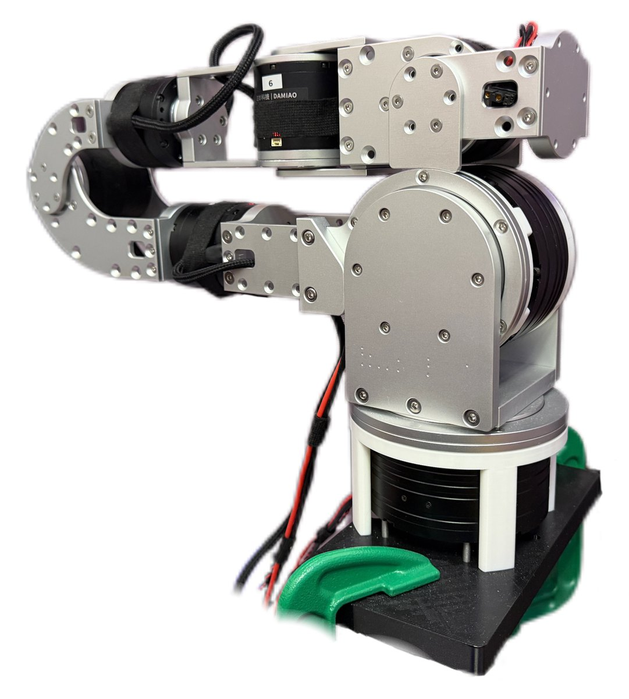
</p>

| 关节 | 电机 | 本体质量 | 控制环 | 关节总线 | 上位机连接 |
|:---:|:---:|:---:|:---:|:---:|:---:|
| 7 轴 + 可选夹爪 | 达妙 DM8009P · DM4340P · DM4310 | 4.63 kg | MCU 上 1 kHz | CAN FD，1 / 5 Mbit/s | 以太网 UDP |

> [!NOTE]
> InfraBot 目前由一个人维护，这是第一次公开发布。机器人描述包、机械臂机械图纸、控制底板及其外壳、固件、SDK 和 ROS 2 驱动都已经公开。签名的固件包附在固件仓库的 Release 中，SDK 的烧录工具可以直接下载。工作半径、负载和重复定位精度还没有实测，所以这里没有列出。

## 特点

- **控制环运行在控制器上。** STM32H743 负责 1 kHz 关节控制、逆运动学、重力补偿，以及关节和笛卡尔两种阻抗与导纳控制。进入重力补偿、阻抗或导纳模式后，不需要 PC 持续发指令。
- **实时和规划两种运动方式。** PC 可以 1 kHz 发送关节或笛卡尔目标，也可以提交 `movej`、`movep` 目标，由控制器插值执行。
- **中英文触摸屏。** 4.3 寸屏显示电机状态、网络设置、柔顺控制参数和机械臂三维视图，每一页都有 STOP 按钮；5 寸屏使用英文界面。
- **签名 A/B 固件升级。** 通过以太网升级，需要在触摸屏上确认；试启动失败会回到原来的固件，也支持 SWD 恢复。
- **开放的硬件和模型。** 机械臂提供整机 STEP、全部机加工零件的 STEP 和物料清单；控制底板提供可编辑的嘉立创 EDA 工程和 Gerber，外壳提供可直接打印的 STL 和 STEP，URDF 带有辨识得到的惯量和摩擦参数。
- **有监控的停止。** 指令断流、反馈过期、驱动器故障时，机械臂会受控停止，保持使能。仍然必须另外接一个独立接线的硬件急停。使用前请先读[安全说明](SAFETY.md)。

## 演示

<table align="center">
  <tr>
    <td align="center"><a href="website/static/video/gravity-compensation.mp4">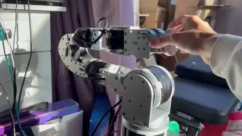</a><br><sub>重力补偿</sub></td>
    <td align="center"><a href="website/static/video/joint-impedance.mp4">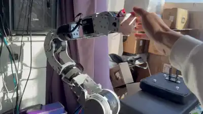</a><br><sub>关节阻抗</sub></td>
    <td align="center"><a href="website/static/video/cartesian-impedance.mp4">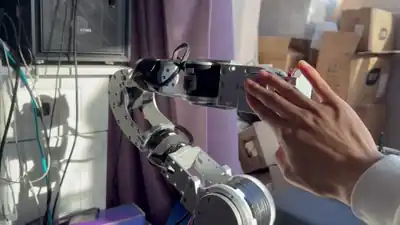</a><br><sub>笛卡尔阻抗</sub></td>
  </tr>
  <tr>
    <td align="center"><a href="website/static/video/joint-admittance.mp4">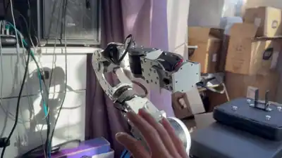</a><br><sub>关节导纳</sub></td>
    <td align="center"><a href="website/static/video/cartesian-admittance.mp4">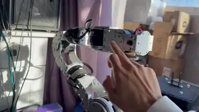</a><br><sub>笛卡尔导纳</sub></td>
  </tr>
</table>
<p align="center"><sub>每种模式都在控制器上以 1 kHz 运行，不需要 PC 持续发指令。点击动图查看完整视频。</sub></p>

### 屏幕 3D 视图

触摸屏上的 3D 视图由控制器根据实测关节角绘制，同时显示末端位置。用手移动机械臂时，画面跟着同步运动。

<table align="center">
  <tr>
    <td align="center"><a href="website/static/video/gravity-compensation-screen.mp4">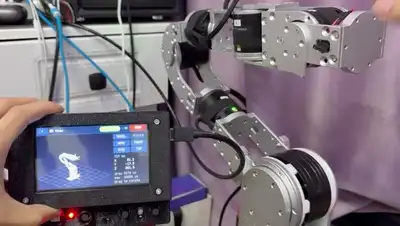</a><br><sub>重力补偿</sub></td>
    <td align="center"><a href="website/static/video/joint-impedance-screen.mp4">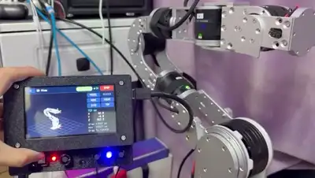</a><br><sub>关节阻抗</sub></td>
  </tr>
</table>

### 触摸屏操作

在运行中的机械臂上逐页操作：机械臂与关节、3D 视图、重力补偿、主菜单，以及笛卡尔阻抗和导纳的参数页。全部页面见下方[触摸屏](#触摸屏)一节。

<table align="center">
  <tr>
    <td align="center"><a href="website/static/video/touchscreen-tour.mp4">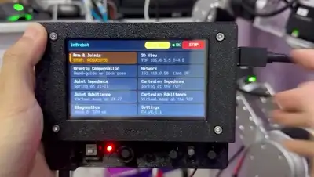</a><br><sub>触摸屏操作（37 秒）</sub></td>
  </tr>
</table>

## 触摸屏

<table align="center">
  <tr>
    <td align="center">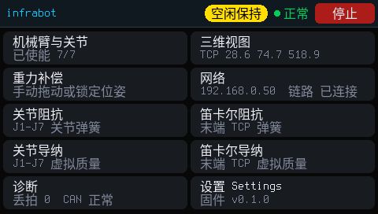<br><sub>主菜单</sub></td>
    <td align="center">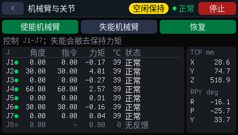<br><sub>机械臂与关节</sub></td>
    <td align="center">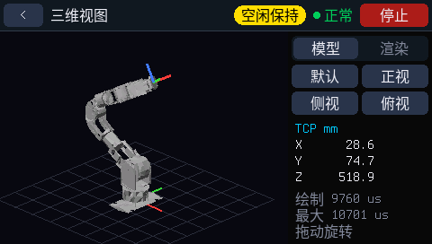<br><sub>三维视图</sub></td>
  </tr>
  <tr>
    <td align="center">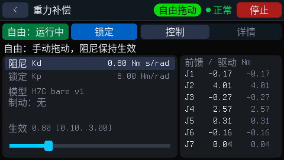<br><sub>重力补偿</sub></td>
    <td align="center">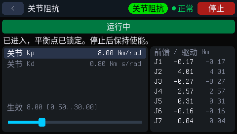<br><sub>关节阻抗</sub></td>
    <td align="center">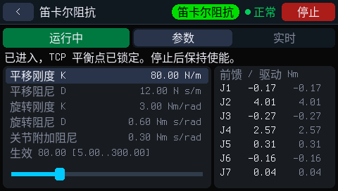<br><sub>笛卡尔阻抗</sub></td>
  </tr>
  <tr>
    <td align="center">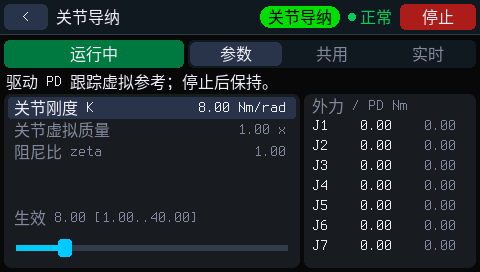<br><sub>关节导纳</sub></td>
    <td align="center">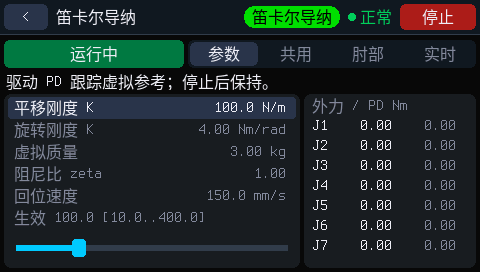<br><sub>笛卡尔导纳</sub></td>
    <td align="center">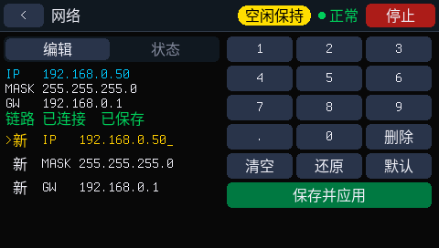<br><sub>网络设置</sub></td>
  </tr>
  <tr>
    <td align="center">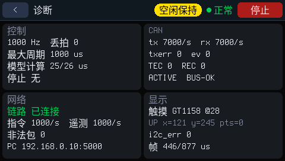<br><sub>诊断</sub></td>
    <td align="center">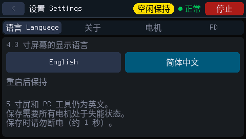<br><sub>显示语言</sub></td>
    <td align="center">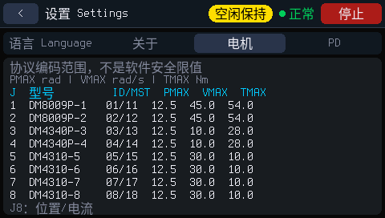<br><sub>电机参数</sub></td>
  </tr>
</table>
<p align="center"><sub>4.3 寸屏的全部页面，也可以切换为英文。每一页右上角都有停止按钮。截图由固件的主机测试生成，运行的是控制器上的界面代码，关节数据为模拟数据。点击图片查看原尺寸。</sub></p>

## 从这里开始

| 我想要…… | 去这里 |
|---|---|
| 在 RViz 里查看机械臂，或者加载 URDF | [infrabot-description](https://github.com/YaolinDong/infrabot-description) |
| 加工机械臂零件 | [infrabot-hardware](https://github.com/YaolinDong/infrabot-hardware) · [物料清单](https://github.com/YaolinDong/infrabot-hardware/blob/main/README.zh-CN.md#物料清单) |
| 制作控制底板 | [infrabot-pcb-4p3](https://github.com/YaolinDong/infrabot-pcb-4p3) · [装配指南](https://github.com/YaolinDong/infrabot-pcb-4p3/blob/main/docs/assembly.md) |
| 打印控制器外壳 | [infrabot-pcb-4p3-enclosure](https://github.com/YaolinDong/infrabot-pcb-4p3-enclosure) · [S8 装配](https://github.com/YaolinDong/infrabot-pcb-4p3-enclosure/blob/main/simple/README.zh-CN.md) · [C3 装配](https://github.com/YaolinDong/infrabot-pcb-4p3-enclosure/blob/main/deluxe/README.zh-CN.md) |
| 编译并烧录固件 | [infrabot-firmware](https://github.com/YaolinDong/infrabot-firmware) · [编译](https://github.com/YaolinDong/infrabot-firmware/blob/main/docs/build.md) · [烧录](https://github.com/YaolinDong/infrabot-firmware/blob/main/docs/flashing.md) |
| 用 C++ 或 Python 控制机械臂 | [infrabot-sdk](https://github.com/YaolinDong/infrabot-sdk) · [API](https://yaolindong.github.io/infrabot-sdk/) · [示例](https://github.com/YaolinDong/infrabot-sdk/tree/main/examples) |
| 用 ROS 2 控制机械臂 | [infrabot-ros2](https://github.com/YaolinDong/infrabot-ros2) |
| 查看哪些版本可以一起使用 | [VERSIONS.md](VERSIONS.md) |
| 安全地操作机械臂 | [SAFETY.md](SAFETY.md) |

## 仓库列表

<!-- repos:start -->
| 仓库 | 内容 | 状态 | 版本 | 许可证 |
|---|---|---|---|---|
| [infrabot-hardware](https://github.com/YaolinDong/infrabot-hardware) | H7C 机械臂的机械图纸：含关节电机的整机 STEP、43 种机加工零件的 STEP，以及带零件预览的物料清单。 | 已发布 | 0.1.0 | CERN-OHL-S-2.0 · MIT · CC-BY-4.0 |
| [infrabot-description](https://github.com/YaolinDong/infrabot-description) | H7C 的 URDF、网格和辨识得到的惯量与摩擦参数，ROS 2 Jazzy 功能包。 | 已发布 | 0.1.0 | Apache-2.0 |
| [infrabot-pcb-4p3-enclosure](https://github.com/YaolinDong/infrabot-pcb-4p3-enclosure) | 4.3 寸控制器的 3D 打印外壳：简单版 S8 为上下壳两件，精装版 C3 带键帽和导光柱。提供 STL 和 STEP。 | 已发布 | S8 · C3 | CERN-OHL-P-2.0 · MIT · CC-BY-4.0 |
| [infrabot-pcb-4p3](https://github.com/YaolinDong/infrabot-pcb-4p3) | STM32H743 核心板和 4.3 寸屏的四层底板：嘉立创 EDA 工程、原理图、Gerber、BOM 和坐标文件。 | 已发布 | R8 | CERN-OHL-P-2.0 · MIT · CC-BY-4.0 |
| [infrabot-firmware](https://github.com/YaolinDong/infrabot-firmware) | STM32H743 固件：1 kHz 关节控制、重力补偿、阻抗与导纳、触摸屏界面、签名 A/B 升级。 | 已发布 | 0.2.0 | Apache-2.0 |
| [infrabot-sdk](https://github.com/YaolinDong/infrabot-sdk) | 基于以太网的 Linux C++17 / Python SDK、Qt 控制界面和固件升级工具。 | 已发布 | 0.2.1 | Apache-2.0 |
| [infrabot-ros2](https://github.com/YaolinDong/infrabot-ros2) | ROS 2 Jazzy 的 ros2_control 驱动，控制 J1–J7：1 kHz 控制循环、关节轨迹控制器和 mock 硬件。 | 已发布 | 0.1.3 | Apache-2.0 |
| `lerobot-robot-infrabot` | LeRobot 机器人插件，用于遥操作、数据采集和策略部署。 | 计划中 | — | — |
<!-- repos:end -->

## 整体结构

```text
PC：C++ / Python SDK、Qt 界面
 ▲
 │  以太网 UDP：指令向下，遥测和回复向上
 ▼
控制器：底板上的 STM32H743，带触摸屏
        1 kHz 关节控制环 · 运动学 · 重力补偿 · 阻抗 · 导纳
 ▲
 │  CAN FD：驱动指令向下，电机反馈向上
 ▼
关节电机：J1–J2 DM8009P · J3–J4 DM4340P · J5–J7 DM4310 · J8 夹爪
```

所有驱动器只由控制器直接控制。同一时间只有一台 PC 拥有控制权，触摸屏随时可以按 STOP。通信协议带版本号：SDK 连接时先核对控制器的协议主版本，一致后才开始发送指令。哪些版本可以一起使用，见 [VERSIONS.md](VERSIONS.md)。

## 安全

> [!WARNING]
> 这是一台研究用机械臂，不是经过认证的工业机器人或协作机器人。软件限位和受控停止都不会切断驱动器电源。请接一个独立的硬件急停；机械臂使能时，人员不要进入它的运动范围；失能驱动器或断电之前，先把机械臂支撑好。第一次上电前请阅读 [SAFETY.md](SAFETY.md)。

## 参与和反馈

问题请提交到对应的仓库。文档、跨仓库的问题和网站相关的问题提交到本仓库。请写明固件和 SDK 版本、控制底板版本以及复现步骤。安全漏洞请按 [SECURITY.md](SECURITY.md) 私下报告。欢迎贡献代码和翻译，见 [CONTRIBUTING.md](CONTRIBUTING.md)。

如果 InfraBot 对你的工作有帮助，可以按 [CITATION.cff](CITATION.cff) 引用。

## 致谢

特别感谢 [@crystal0-0](https://github.com/crystal0-0) 和 [@xensexyq](https://github.com/xensexyq) 对 InfraBot 项目的支持。

<p>
  <a href="https://github.com/crystal0-0"></a>
  <a href="https://github.com/xensexyq"></a>
</p>

## 许可证

每个仓库各自声明许可证。软件、固件和机器人描述使用 Apache-2.0；控制底板和外壳的设计文件使用 CERN-OHL-P-2.0，工具使用 MIT，文档和图片使用 CC-BY-4.0。第三方组件保留各自的许可证，详见各仓库的说明。

本仓库（包括网站、文档和图片）使用 [Apache-2.0](LICENSE) 许可证。底板渲染图 `website/static/img/pcb-4p3.png` 来自 [infrabot-pcb-4p3](https://github.com/YaolinDong/infrabot-pcb-4p3)，仍按 CC-BY-4.0 许可。

Copyright © 2026 **YaolinDong（董耀琳）** · [dong1505lin@gmail.com](mailto:dong1505lin@gmail.com)
